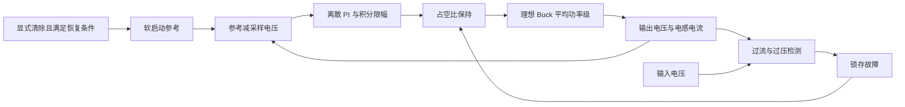
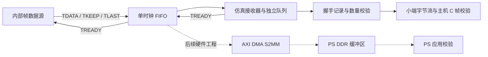

# 三个实验的系统结构与验证范围

本仓库中的数值均来自离线仿真或主机程序验证。真实 ADC、PWM 引脚、DMA、DDR、器件效率和硬件保护行为仍需各自的工程与设备验证。

## P1：反馈控制与故障锁存

平均模型把 PWM 周期内的桥电压平均为 `duty × Vin`，因此适合观察控制包络，不能用它计算开关纹波。电感储能决定电流变化速度；输出电容承担瞬态电流差。PI 增益决定跟踪速度与振荡的取舍，输出限幅不能替代过流保护。

另有独立的 50 kHz 开关模型，按高侧/低侧导通将节点电压在 Vin 与 0 V 间切换，在边沿处分段积分。9 V 输入、固定占空比的输出纹波约 0.752 mV、电感纹波约 0.141 A，已与小纹波公式和积分步长细化比较。该模型使用周期起点采样和立即更新，没有实际 MCU 计算延迟或死区。完整定义见 [PWM 模型](../experiments/p1-c2000-buck/simulation/SWITCHING.md)。

采样保护现已接入同一个 PWM 功率级：正常负载阶跃与原模型逐项一致，三个故障都完成锁存、拒绝不满足条件的清除和显式恢复。过流、过压的检测分别落后模型阈值越过约 17 µs、14 µs。故障时低侧持续导通，储能仍可能使输出继续升高、产生负压和反向电流；这不代表实际硬件关断方式。数据与限制见 [PWM 保护](../experiments/p1-c2000-buck/simulation/PROTECTED_SWITCHING.md)。

固定占空比网表还经过实际 ngspice 36 对照，零初始状态、稳态均值和纹波均已核对。SPICE 的有限边沿与 Python 的瞬时边沿不同，对照中保留实际差值；这一步仍未验证器件或闭环 SPICE 控制。[独立对照](../experiments/p1-c2000-buck/simulation/SPICE_COMPARISON.md)

当前保护在每个控制采样点检查阈值。它不同于 MCU 的模拟比较器和 PWM Trip Zone 硬件路径，也不能证明采样间没有超过限值。故障时模型保持电感、电容状态，用理想续流处理储能，不把状态清零当成关断。

TI 原厂学习路径是 `buck_main.c` 的初始化与 `ISR1` → `BUCK_runIsr()` → 采样、控制与 PWM 更新。初始化还包含 ADC 触发、CMPSS 与 ePWM Trip 配置。具体执行分支取决于原厂实验编号及 CPU/CLA 设置；仓库独立 Python 模型没有连接这些外设。[原厂入口](https://www.ti.com/tool/TIDM-DC-DC-BUCK)

新增独立 C11 控制核心把同样的 PI 和保护状态移到调用者拥有的结构体中，不含外设或动态分配。以四份 PWM 采样轨迹的 Vin/vO/iL 和清除命令为输入，26,004 拍输出及状态与 Python 一致。C 没有重新驱动功率级；本步不证明 C2000 编译结果或中断执行时间。[主机 C 对照](../experiments/p1-c2000-buck/host_c/README.md)

## P2：流数据与背压

AXI-Stream 在 `TVALID && TREADY` 的时钟沿传输一拍；等待期间，源必须保持该拍及侧带字段。FIFO 的深度只能吸收有限突发，不能弥补平均输入速率永久高于输出速率。当前内部测试源可响应背压暂停，真实连续 ADC 还需要额外定义溢出处理。

FIFO 检查器用独立队列核对完整拍，满足 `输入握手 = 输出握手 + 复位丢弃 + 待输出`。复位导致的主动丢弃单独记录。当前 FIFO 使用异步读存储描述，不能把 RTL 仿真通过等同于已映射 Block RAM、已达成 100 MHz 时序或板端吞吐量。

DMA 接入之后，软件必须明确设备/CPU 对缓冲区的所有权、有效字节数、字节序、cache 同步、超时与错误恢复。普通主机数组检查不能验证这些硬件一致性问题。

现有 C 模块已检查真实 RTL 输出的 12 帧、84 字，支持跨批次半帧及序号回绕，错误锁存到显式重置。结束时还要提供期望帧数：仅靠序列号无法发现最后若干整帧完全没有到达。16 项故障测试使用主机 GCC、ASan 与 UBSan；这不是 PS 上 DMA 接收的证据。接口和接入边界见 [C 校验说明](../experiments/p2-zcu104-daq/ps/README.md)。

`daq_stream_top` 已封装 source/FIFO 并完成同样的实际联测。新增 Vivado Tcl 按官方 ZCU104 preset 描述 `AXI DMA S2MM → SmartConnect → PS HP0/DDR`，但本机只有 Vivado Lab，不能执行完整块设计生成或综合。当前 7 字一包对应 28 字节，计划 Simple DMA 每次接收一包；12 帧的离线文件不等于一次硬件 DMA 自动合并 12 个 TLAST。构建命令、时钟/复位和具体待验证项见 [工程说明](../experiments/p2-zcu104-daq/vivado/README.md)。

主机 C 另实现单缓冲区 Simple S2MM 控制流程：准备交给设备、提交一包、有限轮询、检查错误及实际长度、同步回 CPU、校验内容。错误后保存首次状态，显式重启成功才可再用缓冲区。13 项受控回调测试验证这些顺序，AMD Standalone 适配草稿尚未对实际 BSP 编译。[接收流程](../experiments/p2-zcu104-daq/ps/simple_s2mm.md)

通用 Yosys 综合已真实执行：固定 7 字帧、深度 3，RTL 与网表在同一测试激励下均得到 84 条一致接收记录。它证明有限激励下的逻辑一致性，不是完整 Vivado 器件实现、形式等价或时序验证。[综合证据](../verification/yosys-stream/README.md)

独立 AXI4-Lite wrapper 增加运行请求、状态、清除/重启及字/帧/停顿计数。写地址和数据可以分开到达；STOP 等下一次 TLAST 真正握手后完成，不能把写响应当作已经停止。该 wrapper 的原 RTL 和综合网表均通过 23 写/46 读及 70 字输出的有限激励，尚未接入现有 Vivado 地址映射。[控制语义](../experiments/p2-zcu104-daq/rtl/daq_axi_lite.md)

## P4：相移、功率与电流应力

SPS 只改变桥间相移，EPS 还改变一个桥内部的相移，使桥输出出现零电平。公平比较必须保持母线电压、变比、漏感、频率和传输功率相同；相同相移角通常不代表相同功率。

周期模型选择零直流偏置轨道，适合计算稳态功率和电流应力。它不能通过逐周期重新减去电流均值来描述方向切换瞬态。理想端口功率相等只是能量检查；没有器件、死区和损耗模型时，不能将它写成效率或 ZVS 验证。

新增的瞬态模型只在起点设置电流，此后跨周期、换向、锁存和恢复均保留状态。教学电阻 R=0.5 Ω 提供明确耗散，独立积分的端口能量满足 `E1−E2−ER=Δ(½Li²)`。每 2.5 µs 检测一次故障，检测输入越限后锁存，明确清除后才能恢复；阈值不能保证采样间电流不越限。快速反向恢复再次过流的反例保留为测试，详见 [瞬态与保护](../experiments/p4-dab/TRANSIENT.md)。

已有稳态 SPS/EPS 波形还按实际桥臂开关沿检查电流方向。对正电容，节点上升需要电流流入节点，下降需要电流流出节点；映射到原副边时必须考虑电流方向和变比。通过该必要条件仍缺少足够电荷、死区时间和寄生换流过程的验证，因此结果不标为已实现 ZVS。[逐沿判据](../experiments/p4-dab/COMMUTATION.md)

功率 PI 每 50 µs 用上一完整周期的实际积分功率更新相移请求；幅值与速率限制继续由原执行器处理，误差继续推动受限方向时冻结积分。电感状态仍连续，保护优先于控制命令。在固定母线工况下完成正反向跟踪、100 W 不可达请求和返回 10 W，以及原阈值下的故障恢复；这不是输出电压环。[功率闭环](../experiments/p4-dab/POWER_LOOP.md)

同一 PI 增益还在五个固定 V2/R 参数点运行 5→15→−10→0 W 指令；20 段目标在各自 10 ms 窗口内进入并保持误差带。电压不匹配的两点在零功率时仍有约 0.433 A RMS 电流，说明零端口功率不等于无环流。范围只限这五点，未做完整稳定域或效率推断。[五点验证](../experiments/p4-dab/POWER_POINTS.md)

## 阅读与复现顺序

先读各实验 README 中的当前范围，再运行命令，最后把 CSV 与测试日志对应到代码。先解释一个失败工况如何定位，再解释改动改善了什么、牺牲了什么。原厂材料、独立实现、仿真结果与硬件测量应始终分开表述。
