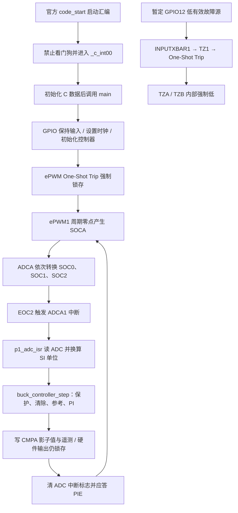

# F280049C：默认禁止输出的真实目标 RAM 工程

2026-11-05，独立新增固件已使用 **TI cl2000 25.11.1.LTS** 实际编译、链接为 **C28x EABI ELF**，链接官方 **C2000Ware 26.02.00.00.LTS F28004x DriverLib** 和 TI RTS。不是主机 mock，也没有读取或复制受限的 TI Buck 源码来生成新增固件。

本阶段结果是一个可审阅的、默认禁止输出的 RAM 工程。没有执行目标固件、连接调试器、烧录 Flash 或运行板卡；没有证明 ISR 满足 20 µs，也没有验证实际 ADC/PWM/Trip 波形。

## 已实际完成的构建

| 项目 | 实际结果 |
|---|---|
| 编译器 | cl2000 25.11.1.LTS，Linux x86_64 程序运行于 WSL Ubuntu 22.04 |
| 编译模式 | C11、C28x、EABI、FPU32、`--fp_mode=strict`、O2、DWARF |
| 控制算法 | 直接编译原 `host_c/buck_control.c`，未改 PI、阈值、锁存或清除语义 |
| 目标 ELF | `.tools/target-build/p1_f280049c_ram.out`，67,732 文件字节，未执行 |
| ELF 类型 | `EM_TI_C2000`、`ET_EXEC`，入口 `code_start`，地址 0 |
| RAM 分配 | 4,358 个 16 位字，即 8,716 个八位字节；含 768 字预留栈 |
| Flash 分配 | 0 字 |
| 数值格式 | C28x `CHAR_BIT=16`，float=32 位，double=64 位、53 位尾数 |
| 数值探针 | 14 个目标编译期常量与 Python binary64 差值均为 0 |

ELF 文件大小包含调试等信息，不能当作运行 RAM 占用。内存统计来自实际链接 map，不代表测得的最大栈深度。目标格式来自 cl2000 生成的探针对象，`ofd2000` 导出数据后解析，并非用主机 `sizeof` 推测。

EABI 保留了原控制器的 binary64 精度，没有为了 FPU32 将算法改成 float。链接映射明确包含 `__c28xabi_addd`、`__c28xabi_mpyd`、`__c28xabi_divd` 等软件 double 辅助函数。编译器的 76 条性能 advice 全部保存在命令记录中；**仍需离线时序分析或将来的目标测量，不能声称当前 ISR 达到 50 kHz 运行要求**。这也符合 [TI 对 EABI double/FPU32 开销的说明](https://software-dl.ti.com/C2000/docs/optimization_guide/phase1/floating_point.html)。

## 初学者可按这条代码路径阅读

下面是依据源码和链接符号核对的调用路径，未作为目标运行轨迹测量：



1. 从 `target_main.c` 的 `main()` 开始：先保持 GPIO0/1 为普通输入，初始化时钟和中断，再调用 `configure_pwm_and_trip()` 与 `configure_adc()`。
2. `configure_pwm_and_trip()` 先把 ePWM A/B 的 Trip 动作设成低并强制 OST 锁存，随后配置内部计数器、CMPA 影子装载和 ADC 触发。没有清除 OST，也没有将 GPIO0/1 切换到 ePWM 引脚功能。
3. `configure_adc()` 让三个 SOC 共用 ePWM1 SOCA，并将 SOC2 的转换完成事件接到 ADCA1 中断。因此 `p1_adc_isr()` 读到的是本组已完成的三个结果。
4. `adc_scaling.h` 只做 ADC 原码→电压/电流换算；`host_c/buck_control.c` 决定保护、参考和占空比。两层职责不同，不把原码直接送给 PI。
5. `p1_adc_isr()` 写 CMPA 影子寄存器和 `p1_telemetry`，最后清中断标志并应答 PIE。软件清除请求只能作用于原控制器，**不能解除本工程的硬件启动锁存**。

`p1_telemetry.boot_inhibit_latched` 记录启动输出禁用状态，和原控制器的 SOFT_START/RUN/FAULT_LATCHED 是两层不同状态。后者仍按原语义运行；即便它报告 RUN，硬件输出也保持禁用。当前代码没有输出启用路径，不是改一个占空比就会驱动功率级的工程。

## ADC、ePWM 与 Trip 的明确接口

| 接口 | 当前源代码配置 | 尚需确认的范围 |
|---|---|---|
| 时钟 | 内部 OSC2，名义 10 MHz，经 ×20/÷2 得 SYSCLK 100 MHz | 实际频率、时钟精度与板级时钟方案 |
| ePWM1 | up-count，分频 1/1，TBPRD=1999，共 2,000 个计数，名义 50 kHz | 目标实际时基、调试暂停行为与功率级要求 |
| ADC 触发 | ePWM1 SOCA，每次 TBCTR=0 触发 | 采样点相对真实开关噪声的位置 |
| ADCA | 12 位单端，内部标称 3.3 V 满量程，ADCCLK=SYSCLK/4 | 板上参考和模拟输入条件；3.3 V 是满量程设置，不是 VREFHI 引脚实测值 |
| 输入电压 | SOC0 / ADCINA0 | 实际排针、分压与校准 |
| 输出电压 | SOC1 / ADCINA1 | 实际排针、分压、负压处理与校准 |
| 电感电流 | SOC2 / ADCINA2 | 实际排针、传感器极性、零点和增益 |
| 采集窗口 | 每个 SOC 20 SYSCLK 周期，名义 200 ns；按 SOC 序号依次转换 | 信号源阻抗与 RC 网络下的采样建立时间 |
| 控制中断 | SOC2 的 EOC→ADCA1→PIE Group1 | 转换总延迟、ISR 最坏耗时与溢出处理实测 |
| CMPA 更新 | `round(duty×2000)`，写影子寄存器，在下次零点装载 | 有效输出启用之前的执行截止时间、端点和量化行为 |
| 外部 Trip | 暂定 GPIO12，异步输入，INPUTXBAR1→TZ1→OSHT1；低有效 | 故障源实际接线、电平、极性、上拉及延迟 |
| 故障动作 | TZA/TZB 内部强制低；启动立即软件强制 OST，永不清除 | 驱动器使能极性、栅极电平和真实续流拓扑 |
| 物理 PWM 引脚 | GPIO0/1 保持普通输入，未接到 ePWM | 实际 PWM/驱动使能引脚、互补关系、死区和外部下拉 |

这些是通过真实 DriverLib 符号编译验证的**逻辑接口分配**，不是已确认的 BOOSTXL-BUCKCONV 排针表。没有配置 CMPSS 硬件电流阈值，外部 TZ1 输入也不能自动等同于 2.5 A。2.5 A、2.4 V、6 V 及 0.1 V/A 清除条件继续只是原模型的教学参数，不能充当器件或板卡安全限值。

三个 ADC 在同一 ADCA 中依次采样，并不是同时测量。ISR 在 EOC2 后才执行，CMPA 在下个周期零点才生效；这与原 Python 模型“周期起点瞬时采样且立即应用 duty”不同，至少引入下一周期更新的时序关系。如果 ISR 没赶上下个装载点，可能再延迟一拍。后续已做 [一周期命令延迟与 ADC/PWM 量化的隔离仿真](../simulation/IO_TIMING.md)，但其假定三个测量同时发生，不是 ADCA 序列或 ISR 的目标运行测量。检测到 ADC 中断溢出时记录永久状态并再次强制 OST；没有自动释放输出。

原 C 控制核心后续已在主机共享库中实际参与 [C/Python 独立 PWM 闭环对照](../host_c/CLOSED_LOOP.md)。该结果沿用上述仿真时序假设，不能替代 C2000 ADC 序列或 ISR 执行时间测量；量化造成的清除盲区也仍然存在。

ePWM B 未配置互补波形及死区，外部驱动使能也未接入。GPIO 输入并不保证实际栅极电平；板卡外部下拉、驱动器禁用和故障极性仍需独立核对。因此“工程禁止输出”不等于已完成可上电功率级的安全设计。

此外，本版本 [官方 `SysCtl_setClock()` 实现](https://raw.githubusercontent.com/TexasInstruments/c2000ware-core-sdk/REL_C2000Ware_v26.02.00.00.LTS/driverlib/f28004x/driverlib/sysctl.c) 在 PLL 校验不通过时可能停留在库内重试。因此 `clock_failed` 只能记录函数实际返回 false 的路径，不能保证覆盖全部时钟故障；尚未验证启动时限或 PLL 故障诊断。调用前 GPIO0/1 已保持输入，此处不修改厂商时钟实现。

## 暂定 ADC 标度及模型差异

`board_config.h` 明确标注以下模拟前端值为占位教学假设，不是从 TI Buck 原理图抄出的元件值：

```text
ADC_pin_V = raw × 3.3 / 4096
Vin       = ADCINA0_pin_V × 10
Vout      = ADCINA1_pin_V × 2
iL        = (ADCINA2_pin_V − 1.65) / 0.1
```

原码为 0–4095；使用每 LSB=满量程/4096 的标称换算，而非把 4095 强行映射到满量程。例：Vin 原码 2048→16.5 V；Vout 原码 1241→约 1.999658 V；电流原码 2048→0 A，2560→约 4.125 A。输入电压与电流的名义每 LSB 分别为 8.056641 mV 和 8.056641 mA，输出电压每 LSB 为 1.611328 mV。

电流零点偏置允许表达正负电流；当前 Vout 通道是单极性标度，无法表示理想 Python 续流模型出现的负输出电压。没有将真实“两个栅极低”的功率级行为冒充成平均模型的“理想低侧持续导通”。这两个模型差异必须在后续板级方案和仿真中处理。

## 数值探针能证明什么

`numeric_probe.c` 由同一个 cl2000、同一组 EABI/精度选项编译。`ofd2000` 提取对象中的格式数组和 14 个 double 常量，`inspect_target.py` 解码后与现有 Python 参数及有限标度算例比较。绝对容差 1e-14 用于这些最大量级 16.5 的有限 binary64 编译期常量，实际差值为 0。

这里确认证据包括：目标 `char` 和主机不同（16 对 8 位）、double 精度相同（64 位/53 位尾数）、指定常量的目标编码及编译期结果相符。**没有运行 C28x 指令、没有重放 C28x 运行时控制器，也没有证明 RTS 运算与主机逐拍相同**。主机 C 的 26,004 拍验证仍独立保留在 `host_c/`；它不能替代目标运行验证。本阶段没有因目标 FPU32 而改变算法精度，故没有引入另一套 float 控制器。

## 首次链接失败如何处理

首次四个源文件编译通过，链接因 `--emit_warnings_as_errors` 将 TI 入口提示 10063 升为错误而停止。已检查官方启动汇编：`code_start` 先禁止看门狗，再跳到 `_c_int00`，没有跳过 C 初始化。该入口不同于默认 `_c_int00` 是有意选择。

失败源码、完整命令和输出保存于 `evidence/target/attempt1/`。在独立 `.tools/target-fix/` 输出目录，以原目标对象和库定向链接，仅将 10063 定为 remark，实际返回 0。最终构建保留 `--diag_remark=10063 --issue_remarks`，使该提示可见；其他警告仍按错误处理。没有改变保护阈值、GPIO 禁用或 OST 锁存。记录见 `evidence/target/isolated-link-fix.json` 与 `build-final.txt`。

## 工具、来源与复现

初始常见安装路径及 PATH 未发现 CCS/cl2000，完整记录位于 `evidence/target/tool-inventory.txt`；这不是全磁盘穷举。随后使用 [TI C2000-CGT 官方页](https://www.ti.com/tool/C2000-CGT) 提供的 25.11.1.LTS Linux 安装器。`dr-download.ti.com` 请求曾返回 403，官方页面对应的 `dr-download-cdn.ti.com` 直达文件正常返回 200，下载 **31,998,404 字节**；没有关闭 TLS、改变身份或使用第三方镜像。

编译器以 unattended 模式仅安装到本实验 `.tools/ti-cgt/`。原安装器调试转储保留于本地忽略的 `.tools/install-logs/`，公开摘要是 `evidence/target/tool-setup-summary.json`。未安装整套 CCS、未改系统 PATH。

DriverLib 取自 [TI 官方仓库的 26.02.00.00.LTS 标签](https://github.com/TexasInstruments/c2000ware-core-sdk/tree/REL_C2000Ware_v26.02.00.00.LTS)，只取得 F28004x 头文件、预编译 EABI 库、设备支持、RAM 链接脚本及许可清单，共 **91 文件、3,661,641 字节**。所有官方文件位于已忽略的 `.tools/c2000ware-26.02/`，保留原版权与许可；公开代码不包含这些原始文件。逐文件 URL/状态/长度见 `evidence/target/driverlib-downloads.json`。

已具备上述依赖时，在 P1 目录执行：

```powershell
& 'E:\python.exe' .\firmware\build_target.py --output firmware/results
```

原生 Linux 从 P1 目录使用同一入口：

```bash
python3 firmware/build_target.py --output firmware/results
```

`build_target.py` 在 Windows 使用 WSL Ubuntu-22.04，在 Linux 直接运行同一位置的 cl2000。所有构建输出均留在 P1 内；`--output` 控制可提交的报告位置，目标二进制和对象始终在 `.tools/target-build/`。工具不会启动 CCS、调试服务器或烧录器。两种调用形式共用代码；本轮实际目标构建采用 Windows→WSL 入口，未额外声称 Linux CI 已运行此目标构建。

新环境获取 DriverLib 可执行 `python3 firmware/fetch_driverlib.py`。编译器安装文件的准确官方 URL 在 `evidence/target/compiler-download.json`；下载后按其 `--help` 支持的参数执行 `--mode unattended --unattendedmodeui none --prefix <P1绝对路径>/.tools/ti-cgt`。安装命令及路径必须限定在本实验目录；安装后应产生 `.tools/ti-cgt/ti-cgt-c2000_25.11.1.LTS/bin/cl2000`。

关键官方接口可在下载的 `adc.h`、`epwm.h`、`xbar.h`、`interrupt.h`、`sysctl.h` 中直接核对；目标数据类型也与 [TI EABI 迁移说明](https://software-dl.ti.com/ccs/esd/documents/C2000_c28x_migration_from_coff_to_eabi.html) 相符。器件能力和时序限制应以 [F280049C 官方资料](https://www.ti.com/product/TMS320F280049C) 为准，本文没有把接口编译成功等同于实际外设测量。

## 可提交文件与当前边界

- `target_main.c`、`board_config.h`、`adc_scaling.h`：独立默认禁用固件和明确的暂定接口。
- `numeric_probe.c`、`inspect_target.py`：实际目标对象的格式与常量检查。
- `build_target.py`、`fetch_driverlib.py`：真实编译链接与有限依赖获取入口。
- `results/`：构建命令/日志、map、链接 XML、去掉目标原始机器码的 ELF 元数据、探针常量及汇总。
- `../evidence/target/`：工具来源、下载、首次失败、隔离链接修复、最终实际构建日志。
- P1 `README.md`：当前阶段入口。

目标 `.out`、TI 库/头文件/安装器和原安装器转储继续保存在忽略目录，不列入公开提交。既有平均/PWM/ngspice/主机 C 结果没有覆盖。此阶段完成目标接口与真实编译链接；未完成实际板级接线与标定、目标端闭环延迟测量、ISR 最坏时序、互补驱动/死区、Trip 硬件动作和目标运行数值验证。
