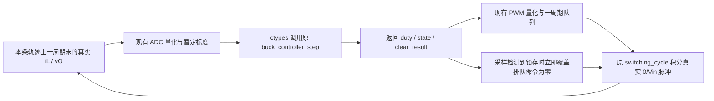

# C 与 Python 各自驱动 PWM 功率级的闭环对照

本页保留首次闭环的历史数据。后续 [测量区间清除修复](CLEAR_MEASUREMENTS.md) 已拒绝本页两个反例；当前量化路径在 80 ms 仍为零码时继续锁存，不能沿用本页的恢复结论。旧数据未覆盖。

更新于 2026-11-06。已在 WSL Ubuntu 22.04 / Linux x86_64 / GCC 11.4.0 实际把原 `buck_control.c` 编译为共享库，并由 Python 3.10 的 ctypes 每拍调用。C 和 Python 两种控制器各自从零状态驱动同一理想 PWM 功率级，完成启动、负载阶跃、输入阶跃、过流、输出过压、输入欠压六个场景。

**C 主轨迹实际调用 36,006 次；两种独立闭环的 duty、reference、vO、iL 最大差均为 0，ADC 原码、PWM 计数、状态、故障、清除与事件完全一致。** 这补上了之前固定 CSV 回放没有覆盖的反馈路径，但仍是主机软件联合仿真，不是 C2000 运行结果。

## 每一拍如何闭合



Python 对照另行初始化 `ProtectedController`、零电感电流、零电容电压和空 PWM 队列，运行相同刺激。两条轨迹均不读取已有 CSV 作为测量输入，也不把另一控制器的输出送入自己的功率级。CSV 只在仿真后导出；末端样本调用控制器并保存结果，但其后不再积分。

`c_controller.py` 仅声明原头文件对应的主机结构和函数类型、翻译枚举及记录事件。控制器状态保存在独立 `BuckController` 结构中；PI、故障锁存、清除及参考斜坡均执行原 C 函数。测试器借用现有 Python 阈值函数来安排显式请求和标记真实/测量清除条件，C 在内部独立判定是否接受，不使用测试器标签替代自己的判断。

ADC 量化和解码仍执行现有 Python 公式；本次实际执行的 C 代码范围仅为控制核心，不包括目标 `adc_scaling.h`、ADC 寄存器、ISR 或 PWM 外设。

`simulate_io_timing()` 只增加可选控制器入口，以及原有输入阶跃和另两种故障刺激；保留原三工况入口和输出路径。ADC 12 位量化、2,000 计数 PWM、一周期 CMPA 延迟、采样点即时 Trip 覆盖、软启动、PI 参数、保护与清除阈值全部沿用。故障时连续积分有符号 L/C 和理想低侧续流支路，不清零状态。

### 独立四周期接管试验

另实际执行 `check_c_takeover.py`：将 Python `ProtectedController.update` 替换为“调用即报错”，只在隔离测试的 C 实例中将初始积分值设为 0.05，并与零初态 C 实例各运行四个周期。生产初始化、参数和阈值不变。结果见 [接管证据](closed_loop_results/takeover.json)：

| 观测 | C 积分初值 0 | C 积分初值 0.05 |
|---|---:|---:|
| 第 0 拍 C 命令 | 0 | 0.05 |
| 第 0 拍实际 duty | 0 | 0 |
| 第 1 拍实际 duty | 0 | 0.05 |
| 第 2 拍（40 µs）真实 vO (V) | 0 | 0.001687483 |
| 第 2 拍真实 iL (A) | 0 | 0.040834136 |

Python 控制更新调用次数为 **0**，七项接管检查全部通过。只改变 C 内部积分状态就经一周期队列改变下一拍的实际脉冲及 L/C 状态，提供了独立于“两种轨迹相同”与“调用计数”的接管证据。

## 正常工况的实际结果

下表 C 与 Python 相同。误差为最后 10 ms 采样平均减 2 V；恢复定义沿用原 ±2% 条件和 2 ms 观察余量。

| 场景 | 采样点数/每种实现 | 平均误差 (mV) | 采样超调 (%) | 事件后最大偏差 (V) | 恢复 (ms) |
|---|---:|---:|---:|---:|---:|
| 启动 | 5,001 | 0.859255 | 0.305313 | 0.365081 | 10.38 |
| 50 ms 负载 4→2 Ω | 5,001 | 0.809611 | 9.983824 | 0.246009 | 5.18 |
| 50 ms 输入 9→7.5 V | 5,001 | 0.687058 | 1.138362 | 0.471156 | 15.70 |

三个场景的原采样性能检查均通过，没有调参。负载场景本轮 0.5 µs 最大积分子步的周期节点峰值为 **2.200345783 V / 10.017289%**；上一阶段 0.25 µs 的定向核对为 **10.017299%**，见 [原细步长证据](../evidence/io-timing-refinement/summary.json)。本轮未重复细步长仿真，也没有把采样检查通过表述成周期内峰值通过。

## 故障、续流与显式恢复

三种刺激均从 50 ms 持续到 65 ms：过流用 0.25 Ω 低阻负载，过压将输入升至 14 V，欠压将输入降至 4.5 V；随后恢复 9 V、4 Ω。主轨迹先发送一次活动故障清除请求，再在有条件时发送一次残余状态请求，最后在 80 ms 显式清除。每种实现、每种故障保存 7,001 个控制样本。

| 故障 | 首次锁存 (ms) | 真实阈值跨越至采样检测 (µs) | 清除后恢复 (ms) | 假想不满足真实条件的清除候选数 |
|---|---:|---:|---:|---:|
| 过流 | 50.32 | 15.860–16.320 | 30.38 | 2 |
| 输出过压 | 50.30 | 13.807–14.301 | 30.40 | 42 |
| 输入欠压 | 50.00 | 0 | 30.36 | 0 |

欠压的零检测延迟来自输入刺激恰与采样同步。其他区间来自相邻积分节点，并非真实 ADC/ISR 时间或精确连续根。C 和 Python 的故障时刻与事件相同。主轨迹均只在 80 ms 接受清除；该时刻真实状态满足原清除条件。过流、过压各拒绝一次活动和一次残余请求；欠压解除时已不满足发送残余请求的测试条件，所以仅有活动拒绝和 80 ms 接受。

实际验证了排队占空比被 Trip 覆盖、锁存期间开关节点为零、锁存与清除两侧 L/C 连续、续流采样储能单调下降，以及清除后的软启动和真实 PWM 脉冲。过压周期内输出仍最高达到 2.534565 V、最低 -1.935493 V；欠压最低 -1.526391 V。它们是理想模型的结果，不是板卡可承受范围。

## 量化清除盲区仍然存在

两种控制器均对主轨迹中的测量执行一次独立副本上的假想清除，用来验证条件缺口。副本有自己的 C/Python 状态和事件，**不会把假想命令、状态或功率级结果送回主轨迹**。

- **负电压信息丢失：**过压场景 51.46 ms，真实 vO=-1.906609 V、iL=0.005453 A、储能 0.854265 mJ；单极性 Vout 与电流解码为 0 V/0 A，C 副本和 Python 副本都接受清除。42 个分散采样点存在这种真实/测量条件不一致。
- **电流量化跨越清除边界：**过流场景 52.72 ms，真实 iL=0.104541 A，解码为 0.096680 A；真实 vO=0.031066 V，储能 1.428965 µJ。副本接受清除，尽管真实电流超过原 0.1 A 条件；此类候选共两拍。这项发现不依赖负电压。

两类请求都没有在主轨迹发生。本实验没有改阈值、加裕量或替换单极性标度来消除发现。C 与 Python 相符只证明这两种实现的行为一致，不证明测量值能完整反映功率级状态。

## 编译、验证与一次审阅差异

构建与六场景闭环的四条真实工具命令均退出 0，stderr 为空；随后单独执行的四周期接管试验也退出 0，其日志另存。GCC 使用 C11、严格警告作为错误、`-O1 -fno-fast-math -ffp-contract=off -fPIC -shared`，并启用 `-fsanitize=undefined -fno-sanitize-recover=all`；运行时 UBSan 遇错终止。共享库位于忽略目录 `.tools/host-c-closed-loop/`。这一阶段是 UBSan；之前独立回放的 ASan 证据没有扩大到本次 ctypes 进程。

12 条闭环轨迹的原性能/物理检查及六组实现对照全部通过。电压/电流相同来自相同量化 PWM 对相同积分器的驱动；控制器未量化 duty/reference 比较沿用之前 1e-11 / 1e-14 容差，离散结果精确比较。实际差值均为零。新增可选入口后重新运行原 **13 项 unittest，全部通过**，用时 21.019 s。

后续只读审阅曾用整行文本精确相等比较旧 Windows Python 3.14 与本轮 Linux Python 3.10 CSV，启动案例触发断言，见 [原差异记录](../evidence/host-c-closed-loop-report-audit-attempt1.json)。离线抽取全部 14 个不同样本，在两个运行环境复算同一储能公式，发现 `vO**2` 末位不同，各自精确复现原记录，最大储能差 2.1684×10⁻¹⁹ J。三个旧场景共 17,003 行的其他全部字段，包括真实状态、ADC、命令和保护状态，均精确相同。

修正范围仅为独立审阅脚本：逐字段核对轨迹，并明确记录每个派生储能差异的原生复算结果；没有修改模型、数据或放宽原测试。隔离复算及修正后的核对保存在 [算术审阅目录](../evidence/host-c-energy-audit/summary.json)。未因此重跑完整仿真。旧版 Windows 指标与本轮 Linux 最后 10 ms 算术平均的末位差也不作为跨环境逐位一致的声明。

## 复现和文件

从 P1 目录运行：

```powershell
& 'E:\python.exe' -B .\host_c\run_closed_loop.py
& 'E:\python.exe' -m unittest discover -s .\simulation -p 'test_*.py' -v
```

Linux CI 的最小入口为：

```bash
python3 -B host_c/run_closed_loop.py
```

当前入口先编译共享库和 C 边界/测量测试，再运行六场景闭环及四周期接管检查。原生 Linux 子进程使用入口自身的 `sys.executable`，继承 CI 选定的 Python；Windows 分支经 WSL 使用 `/usr/bin/python3`。本页首次实测为 Windows Python 启动 WSL GCC 与 Linux worker，四周期试验随后单独调用。最新入口已为每个新输出目录分配独立 `build/`，拒绝复用已有输出；本页固定构建目录的旧产物仍保留。

- `c_controller.py`：ctypes 主机接口和原生控制器实例。
- `closed_loop_worker.py`：独立闭环执行、实际脉冲/保护验证和结果对照。
- `run_closed_loop.py`：GCC 构建、Linux worker 调用和完整命令留证。
- `check_c_takeover.py`：禁止 Python 控制更新的独立四周期接管试验。
- `closed_loop_results/`：62 个文件，约 42.72 MB；12 套完整采样、周期统计、有限波形和事件，六份逐拍比较，指标、比较汇总、参数、状态及命令记录，另含两份极短接管轨迹和检查结果。
- `../evidence/host-c-closed-loop.txt`、`host-c-closed-loop-regression.txt`：本轮实际运行与回归日志。
- `../evidence/host-c-takeover.txt`：四周期接管试验的实际运行日志。
- `../evidence/host-c-energy-audit/`：14 个差异样本、两环境复算与审阅脚本；不参与闭环控制。

真实 C 核心、头文件和目标固件没有修改。该离线阶段没有外部阻碍；若要进一步声称板卡闭环与保护已验证，仍需确定实际模拟前端/负压处理、GPIO 与驱动拓扑，并测量目标 ADC 序列偏移、ISR 最坏耗时和 Trip 动作。当前固件仍保持 GPIO 输入、启动禁止输出和 OST 锁存，未连接硬件或烧录。
