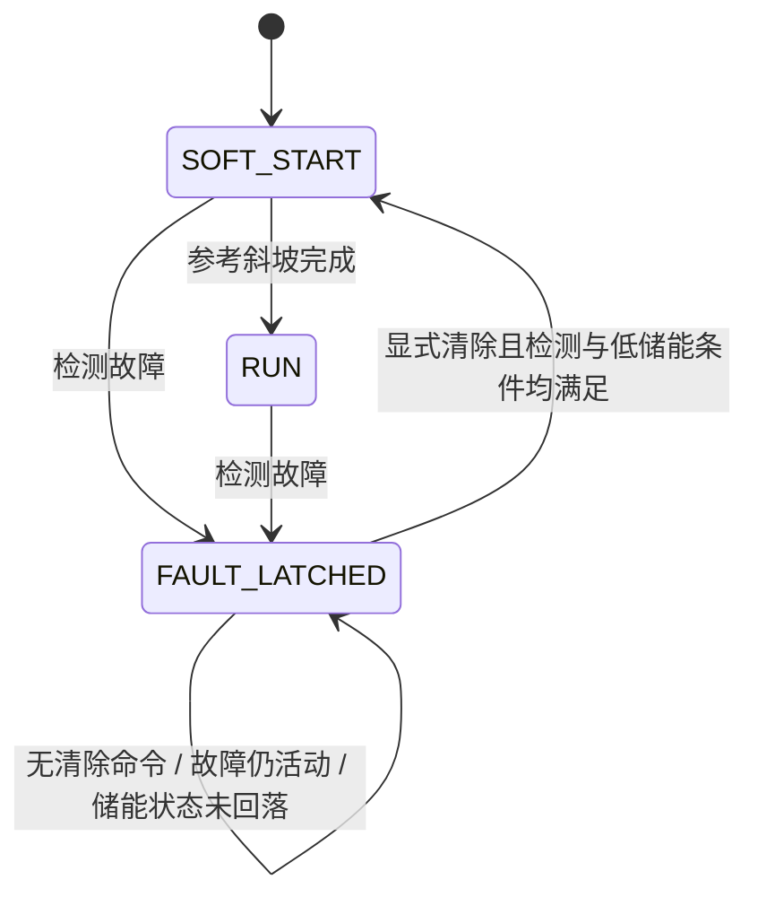

# 采样保护、锁存与显式恢复：独立平均模型第二步

本步在第一步理想 Buck 平均模型之外增加一个小型控制器包装层。原有 `buck_model.py`、PI 参数和三工况数据未改动；没有移植 TI 固件，也没有硬件保护性能或安全认证的声明。

## 检测与恢复规则

下表均为**教学假设**。不能据此设置评估板比较器、驱动器或电源限值。

| 检测/清除条件 | 数值与行为 |
|---|---|
| 过流 | `abs(iL) >= 2.5 A`，正向与反向均检测 |
| 输出过压 | `vO >= 2.4 V` |
| 输入欠压 | `vin <= 6 V` |
| 故障锁存 | 任意检测条件满足即锁存首次原因，积分器清零；后续活动原因另行记录 |
| 故障输出 | `duty = 0`，继续积分功率级状态，不清零电感电流或电容电压 |
| 显式清除 | 收到一次清除请求，且没有活动检测故障，并满足 `abs(vO) <= 0.1 V`、`abs(iL) <= 0.1 A` |
| 清除成功 | 积分器清零，参考从 0 V 重新以 100 V/s 斜升，20 ms 后到 2 V |

检测每 20 µs 进行一次，没有异步比较器、采样噪声、迟滞、器件延时或周期内峰值检测。输入在模型中的瞬时变化不会跳过当前状态，更新控制器后占空比保持一周期。

低储能清除条件用于避免从仍带电的电容/电感直接切换到 0 V 参考，产生较大的反向电流；它是本模型的明确恢复条件，不是由硬件数据手册导出的值。即便采样值恢复正常，控制器也不会自动恢复。调用者每个 `clear_request=True` 表示一次显式命令；本测试器发送脉冲式请求，没有实现按钮电平、通信协议或请求队列。



## 故障状态的物理含义与边界

这里的 `duty=0` 表示**理想同步 Buck 低侧持续导通的续流模型**，不等于两只 MOSFET 全部关断，也不等于驱动器禁用或真实硬件安全关断。沿用原有有符号电感电流和电容电压状态：

```text
L diL/dt = -vO
C dvO/dt = iL - vO/R
E = L*iL²/2 + C*vO²/2
dE/dt = -vO²/R
```

模型储能会通过负载耗散，LC 可发生反向振荡。实际二极管、体二极管、输出负压钳位、死区、开关断态拓扑和器件额定值均未建模。因此本步只验证采样状态逻辑和指定理想支路的能量行为，**不能证明真实功率级被保护**。

过压工况中观察到 `iL` 最低约 **-3.208 A**、`vO` 最低约 **-1.932 V**；欠压工况最低约 **-2.535 A / -1.527 V**。这些数值保留在 CSV 中，没有通过裁剪状态隐藏。反向电流超过限值时，`active_faults` 会记录过流，首次锁存原因仍保持原始过压或欠压。

还有一个可观测性限制：低阻负载故障在停止供能后可能不再产生过流读数，**测量条件正常并不证明负载短路已移除**。控制器没有负载诊断。拒绝清除的保证针对仍满足阈值的检测条件；完整恢复工况由测试器先在 65 ms 移除刺激，再在 80 ms 发出显式清除请求。此处没有宣称能够诊断所有持续的外部故障。

## 实际运行的工况

前三个正常工况与第一步相同，仍运行 100 ms；每项 5,001 行。保护工况均运行 140 ms；每项 7,001 行。三个故障刺激均从 50 ms 开始、在 65 ms 移除，不直接改写电感电流或电容电压：

| 工况 | 数学模型中的刺激 |
|---|---|
| `overcurrent` | 负载 4 Ω→0.25 Ω，输入仍为 9 V，使闭环电流升高 |
| `overvoltage` | 输入 9 V→14 V，负载仍为 4 Ω，使输出动态超过阈值 |
| `undervoltage` | 输入 9 V→4.5 V，负载仍为 4 Ω |

测试器在首次检测到阈值满足的同一采样时刻发送一次明确清除请求，验证其被拒绝。之后即便读数回落或刺激在 65 ms 结束，也保持锁存；80 ms 才发送第二次清除请求。独立单元测试另将故障测量条件持续保持三个采样并逐次请求清除，验证持续拒绝；它还验证储能未回落时拒绝清除。

## 本轮结果

| 工况 | 首次锁存时刻 (ms) | 活动故障下清除 | 成功清除时刻 (ms) | 从清除到 ±2% 恢复 (ms) | 最后 10 ms 平均误差 (mV) |
|---|---:|---|---:|---:|---:|
| 过流 | 50.32 | 拒绝 | 80.00 | 30.48 | -0.248592 |
| 输出过压 | 50.30 | 拒绝 | 80.00 | 30.50 | -0.248608 |
| 输入欠压 | 50.00 | 拒绝 | 80.00 | 30.50 | -0.248585 |

首次锁存时刻包含功率级响应与采样时序，不是硬件比较器延迟。恢复时间包括完整的 20 ms 软启动；判定进入 2 V±2% 后持续到记录结束，且至少有 2 ms 观察余量，分辨率为 20 µs。每个故障工况仅锁存一次，并且只有一次清除被接受。正常三工况无误触发，电压、电流、参考和占空比与原模型逐样本完全相同。

包括原有检查在内，共 **6 项 unittest 测试通过**：原开环关系、原三工况响应、正常波形不变、活动故障/残余储能下拒绝清除与禁止自动重启、物理扰动下锁存和软启动恢复，以及续流能量检查。各测试含必要的子工况，未放宽第一步的检查条件。

续流独立检查从 `iL=0.5 A, vO=2 V` 开始，以 `duty=0, R=4 Ω` 积分 20 ms：初始储能 **0.0009675 J**，末态储能 **2.448698×10⁻⁸ J**，负载耗散积分 **0.000967475515342 J**，能量平衡残差约 **-2.323×10⁻¹² J**。原始输出见 `evidence/protection-tests.txt`；耗散使用梯形积分，与功率级 RK4 不同。

## 复现与文件

在实验目录执行（仅 Python 标准库）：

```powershell
Set-Location 'E:\UserData\Documents\ChatGPT\硬件\experiments\p1-c2000-buck'
& 'E:\python.exe' .\simulation\run_protection.py
& 'E:\python.exe' -m unittest discover -s .\simulation -p 'test_*.py' -v
```

- `protection.py`：保护阈值、状态与恢复控制器、六个工况。
- `run_protection.py`：完整 CSV、参数、状态转换和指标导出。
- `test_protection.py`：新增四项定向测试；保留 `test_buck.py` 两项原测试。
- `protection_results/<case>.csv`：原始时域数据、储能、活动/锁存故障、清除请求及结果。
- `protection_results/<case>_events.csv`：状态转换与清除接受/拒绝记录。
- `protection_results/parameters.json`、`metrics.json`、`metrics.csv`：实际参数及汇总。
- `../evidence/protection-run.txt`、`protection-tests.txt`：本次实际执行日志。

本轮没有发生运行或测试失败。未做大规模 PI 扫描、固件移植或硬件操作；原厂 `vendor/` 保持本地忽略。
