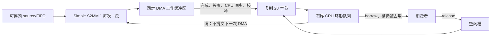

# 有界接收队列与主机测量

本阶段用 **一个固定 DMA 工作缓冲区 + 容量 1～8 包的 CPU 环形队列** 分开接收与消费。每包仍是 7 字、28 字节；只有经过原 Simple S2MM 完成/长度检查、CPU 同步及帧校验的完整包才会复制入队。没有实现 SG、多笔并发 DMA、零复制或 Linux 驱动。

实际执行了 13 项队列测试和 9 组主机测量，全部通过。成功 payload 来自本阶段真实 RTL 捕获的 12 帧/336 字节；计时修复后的 9 组定向复测复用该文件，未重新捕获。DMA/控制状态由主机回调注入，不能将这些测试视为 DMA IP 或 cache 仿真，更不能将下面的速率视为板端性能。

## 实现和所有权

核心为 [daq_queue.c](daq_queue.c) 和 [接口](daq_queue.h)，复用 `daq_session → simple_s2mm → frame_validator`。没有改动 RTL、原长度判据、错误优先规则、CPU 同步顺序或校验器。session 原有阻塞 STOP 拆出 request/check 两个小操作供队列使用；原 `daq_stop` 仍保留，原 9 项流程测试实际回归通过。

| 存储/阶段 | 所有者与可执行操作 |
| --- | --- |
| DMA 工作缓冲区准备/在途 | 设备拥有；原 `for_device` 在提交前调用，CPU 和消费者不得读取 |
| 合法包完成、长度正确、`for_cpu` 后 | CPU 拥有；校验成功后复制恰好 28 字节进一个空闲槽 |
| 已入队、尚未借出 | 队列拥有；生产者不能覆盖，等待消费者 |
| `dq_borrow` 后 | 消费者以 const 指针借用队首；该槽继续计入队列占用，后续生产可用其他空闲槽 |
| `dq_release` 后 | 槽重新空闲；旧指针失效，消费者不能继续保留或使用 |

队列槽不是 DMA 目标，因此不对它们伪造 DMA/cache 同步。真实 Standalone 接入仍需独立且按实际 cache 行对齐的 DMA 分配，缓存操作覆盖完整专用跨度；CPU 队列不能落在该 DMA 分配/缓存跨度内。主机回调只检查操作顺序，不证明物理 cache 一致性。

每个 `daq_queue` 内有固定 8 个 28 字节槽（224 字节 payload 存储），逻辑容量可选 1～8。比较容量不意味着该 C 结构体的物理分配大小随之变化；它始终固定大小，不调用分配器。DMA 工作缓冲区和平台要求的缓存对齐空间另外提供。

这是单调用者协作式 API：可交错执行生产/消费，不允许多个线程或 ISR 并发访问。没有为此增加锁、原子指针或通用驱动框架。

## 满队列、停止与失败

- `dq_produce` 遇到满队列立即返回 FULL；不会调用寄存器、cache 或 DMA 回调，不覆盖任何槽。借出的槽也算满队列的一部分。
- 满队列采用**停止提交下一包 DMA**的策略，不自动复位或发 STOP。现有可停顿模式源会在 DMA 内部缓冲和 RTL FIFO 用尽后收到背压；本次主机测试只证明没有继续提交，不模拟真实 DMA 内部缓冲，也不证明不可停顿 ADC 不会溢出。
- 消费者释放一个槽后才能接收下一包。若消费者长期不释放，队列继续返回 FULL，保持原数据；不存在“丢最旧包”或覆盖策略。
- 正常停止用 `dq_request_stop(queue, 原定帧数, 最大附加包数)`；随后继续调用 produce/borrow/release。STOP 所需的每个排空包都经过校验并入队，不调用会悄悄覆盖单工作缓冲区的批量排空逻辑。
- 排空遇到满队列仍等待消费者释放；达到附加包上限则锁存 STOP_LIMIT。停止状态、硬件帧数与**原定**目标的检查沿用 session，不能用已接收数改写目标。
- DMA/超时/长度/内容错误时，坏包不入队，生产错误锁存；此前已入队的有效包仍可消费。原 receiver 的状态、首错证据及 DEVICE/CPU owner 保留。
- 队列非空或存在消费者借用时，显式 `dq_restart` 返回 PENDING，且不调用任何平台操作。有效包全部释放后才允许重启；重启失败不清原接收错误，不返回未确认停止的 DMA 缓冲区所有权。成功才建立新的帧 0 周期并清队列统计。

`dq_produce` 的 DONE 表示采集和帧数检查已结束，不代表消费者已经释放队列。仍应消费完 `count` 个包后才重启。`produced = consumed + count` 始终成立；`high_water` 包含借出的队首槽，`full_returns` 只是满队列返回次数，不是硬件 FIFO 停顿周期。

## 2026-11-05 功能验证

[test_daq_queue.c](../tests/test_daq_queue.c) 与小型 [主机回调](../tests/queue_host.c) 通过 GCC 11.4.0 的 C11、`-Wall -Wextra -Werror -Wpedantic`、AddressSanitizer 和 UBSan；编译/运行退出码为 0。

| 情况 | 实际检查 |
| --- | --- |
| 容量 1、3、8（3 项） | 每项按序生产/消费 12 包，跨越环形索引回绕；高水位分别为 1、3、8；12 次提交、13 次 CPU 同步（含启动一次） |
| 消费者长期借用 | 借出第一个包后继续生产，满后尝试 3 次仍不覆盖；无新增平台调用；未释放前重启被拒绝 |
| 满队列下 STOP | 先填满 3 包，再 STOP；释放一个槽才允许排空第 4 包，4 包全部按序消费 |
| DMA 错误、超时、短包、超长长度报告、内容破坏、提交失败（6 项） | 第 3 包失败；只保留先前 2 个有效包，坏包不发布；之后仍逐包核对并消费有效前缀 |
| 失败重启后显式恢复 | 先保留原 SUBMIT_ERROR，成功重启后再按帧 0 开始完整生产/消费 12 包 |
| 排空上限 | 不多提交一包；已入队的有效包仍可消费，STOP_LIMIT 保持锁存 |

合计 **13/13**。超时最多查询 3 次；短包和超容量报告不执行 CPU 同步；内容错误只在合法 CPU 同步后发现。测试后端在同步前把 DMA CPU 视图填为无效内容，直到 `for_cpu` 才提供实际 RTL payload。超长测试只注入 32 字节长度报告，不往 28 字节数组越界写入；它不证明软件能阻止真实 DMA 已发生的越界。

同一入口实际重新运行上游：session **9/9**、原接收 **13/13**、原校验器 **16/16**，以及 AXI-Lite RTL TB **26 写、55 读、77 字/11 帧**，全部通过。每次成功数据捕获仍为 84 个真实 RTL 输出字；测量时的重复使用另行标记为重放。

证据：[本阶段汇总](../results/daq_queue/summary.json)、[13 项矩阵](../results/daq_queue/fault_matrix.csv)、[严格编译日志](../results/daq_queue/c_compile.log)、[测试日志](../results/daq_queue/c_test.log)、[上游回归](../results/daq_queue/upstream/summary.json)、[新 RTL 捕获](../results/daq_queue/upstream/receiver/capture/rtl_capture.csv)。

## 主机测量：缓冲容量与消费等待

[bench_daq_queue.c](../tests/bench_daq_queue.c) 使用相同队列和主机回调，以 `gcc -O2` 单独编译，不带 sanitizer。功能测试使用 sanitizer；二者构建参数分别记录，不把带插桩的运行速率混作正常构建结果。

测量使用 `CLOCK_MONOTONIC`。每组重放真实 12 帧文件 20 个新周期，共实际核对并消费 **240 帧、6720 有效字节**。消费者借用一包后请求等待 0、200 或 1000 微秒，再检查内容并释放；真实睡眠可能因主机调度而更长。队列满且只能等待消费者时使用 nanosleep，不忙循环耗尽 CPU。

各指标定义：

- 有效字节：已校验并消费的完整包数 × 28；失败包不计入。
- 主机交付帧率/字节率：实际消费量除以该组墙钟耗时，包含回调、校验、复制、重启和消费等待；不含输出 CSV 的打印时间。
- 队列延迟：成功入队的 `dq_produce` 返回后采起点；消费者完成内容检查且 `dq_release` 成功返回后采终点，报告平均值和最大值。它不包括源到 DMA 完成的时间，不是端到端采集延迟。
- 高水位：CPU 环形队列的最大占用，包含借出的包；不是 RTL FIFO 占用。

以下为计时修复后有消费等待的单次观测，全部属于**无实际 DMA/DDR 访问的主机回调工作负载**：

| 容量（包） | 请求消费等待（µs） | 主机交付帧/s | 平均队列延迟（µs） | 最大队列延迟（µs） | 高水位 |
| ---: | ---: | ---: | ---: | ---: | ---: |
| 1 | 200 | 3123.0 | 319.4 | 535.3 | 1 |
| 3 | 200 | 3118.8 | 880.9 | 1314.8 | 3 |
| 8 | 200 | 3140.3 | 1803.8 | 2659.9 | 8 |
| 1 | 1000 | 898.0 | 1112.8 | 1256.0 | 1 |
| 3 | 1000 | 900.3 | 3053.7 | 3511.6 | 3 |
| 8 | 1000 | 901.0 | 6284.7 | 9031.3 | 8 |

本次观察中，增大队列使高水位和排队延迟上升，消费等待主导的帧率变化很小。更深缓冲能吸收积压，不能让慢消费者本身更快。0 微秒组总运行仅约 70～126 微秒，属于很短的主机检查，不能用其速率推断 FPGA 吞吐。没有测量 CPU 使用率、DMA 时钟、DDR 带宽或板端性能，也不据此选择硬件 FIFO 大小。

修复后的完整 **9/9** 组参数、有效字节率和原始纳秒耗时见 [host_measurements.csv](../results/queue_timing_fixed/host_measurements.csv) 和 [复测汇总](../results/queue_timing_fixed/summary.json)。只记录每组首个周期的 12 包延迟，共 108 行：[有限延迟轨迹](../results/queue_timing_fixed/first_epoch_latency.csv)。[测量构建日志](../results/queue_timing_fixed/compile.log) 和 [运行日志](../results/queue_timing_fixed/run.log) 保留真实命令与退出码。

首次定位到的缺陷是计时终点早于 `memcmp` 和 `dq_release`，与原文“检查并释放后”的定义不一致，遗漏了这两步耗时。[修复前源码](../results/queue_timing_before/bench_daq_queue.c)、[测量](../results/queue_timing_before/host_measurements.csv) 和 [延迟轨迹](../results/queue_timing_before/first_epoch_latency.csv) 已保存。最小修复先保留消费索引，再在成功释放后采终点；在 `.runs/queue_latency_fix` 隔离副本严格编译并通过 9 组定向复测后，同步回测量源码。此次复用已有 RTL payload，未重采 RTL，也未重跑上述 13 项功能测试。原 [results/daq_queue 测量](../results/daq_queue/host_measurements.csv) 及功能测试证据完整保留；旧延迟仅代表修复前计时范围，不再作为当前表格的数据。

## 使用入口与数据流

从实验根目录执行，新目录保留旧证据：

```powershell
& 'E:\python.exe' .\scripts\run_daq_queue.py --output results/daq_queue_recheck
```

Linux 使用 `python scripts/run_daq_queue.py ...`。默认入口先调用原 `run_daq_session.py`，完成上游回归和新 RTL 捕获，再跑队列测试及测量，因此统一检查可用它替换旧 session 入口，避免重复底层检查。若上游已在同一次统一检查中执行，也可传 `--capture` 指向本实验内已有的真实 `rtl_capture_le.bin`；这会跳过上游回归，汇总明确标记“复用文件、未重新捕获”，不会据文件长度声称重新运行过 RTL。



寄存器决定源的启停，DMA 拥有工作缓冲区期间 CPU 不读它；完成并同步后校验器确认包正确，队列再保存一份独立 CPU 数据。消费者持有这份数据不会阻止其他空槽接收，直到队列达到容量；释放才允许复用。完整 Vivado、真实地址导出、A53 BSP/交叉编译、专用 DMA 分配及硬件 cache 验证等依赖仍见 [第一阶段说明](daq_session.md)，本阶段没有替身 BSP 或上板操作。
