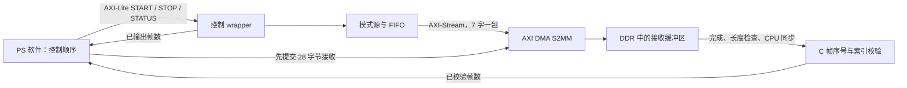

# 控制寄存器、DMA 和校验器的离线集成

本阶段把 `daq_axi_lite` 加入 Vivado Tcl，并实现正常启停/重启的可移植调用顺序。**实际执行的是 RTL wrapper 测试和 x86_64 主机 C 测试；没有完整 Vivado、BSP 编译、DMA IP 联合仿真或板端执行。** 地址导出脚本只在真实 Vivado 的已分配块设计里运行，当前没有生成任何假基址。

## 工程入口与地址

[create_project.tcl](../vivado/create_project.tcl) 加入控制 wrapper 源码。[create_bd.tcl](../vivado/create_bd.tcl) 将 PS HPM0_LPD 接到 1×2 SmartConnect，M00 到 DMA AXI-Lite，M01 到 `stream/S_AXI`；流输出仍到 DMA S2MM，再经 1×1 SmartConnect/HP0_FPD 到 PS 内存系统。RTL 新增接口属性和独立采集复位；接口推断和地址分配仍需真实 Vivado 验证。

`assign_bd_address` 和 `validate_bd_design` 成功后，[export_addresses.tcl](../vivado/export_addresses.tcl) 读取实际映射的 OFFSET/RANGE，计划输出到 `build/vivado_zcu104/`：

- `address_map.csv`：控制/DMA 的从地址段、PS 映射段、基址、范围。
- `daq_addresses.h`：`DAQ_CTRL_BASE_ADDRESS`、`DAQ_DMA_BASE_ADDRESS`，值只来自实际地址段。

该头文件不是 BSP，也不分配 DDR 缓冲区。一个目标若没有唯一的已分配地址，脚本报错供检查，不选择猜测地址。依据 AMD [UG835 2025.2 get_bd_addr_segs](https://docs.amd.com/r/2025.2-English/ug835-vivado-tcl-commands/get_bd_addr_segs) 的 `-of_objects`、`-addressing` 及 OFFSET/RANGE 属性。当前三个 Tcl 仅通过 [info complete 文本检查](../results/daq_integration/tcl_text_check.log)，没有执行 Vivado 命令，**地址 CSV/头文件尚不存在**。

复位现在分开：系统 `peripheral_aresetn` 接 wrapper 的 `aresetn`，保持 AXI-Lite 通道运行；DMA `s2mm_prmry_reset_out_n` 接新增的 `stream_resetn`，只清采集状态、统计和 source/FIFO，并关闭输出。STATUS bit 2 报告流侧复位尚未释放，复位中 START 返回 SLVERR。这避免 DMA 持续拉低流侧复位时把控制总线一起挂住。TB 已实测流侧复位期间，先前被反压的 R 响应不丢失，STATUS 仍可读取；释放后从帧 0 开始。实际 AMD IP 的复位脉宽、同步与释放条件仍需完整 IP 验证。

## 软件如何走完一个周期

[daq_session.c/.h](daq_session.c) 复用原 `simple_s2mm` 和 `frame_validator`，只加两个寄存器操作回调，不重写 DMA 驱动。平台 DMA/cache 操作仍使用同一组既有回调。

1. `daq_init` 设置内存状态；`daq_restart` 调用原 DMA 重启，最多查询 `poll_limit` 次 STATUS 的运行/待停止位，确认停止后写 COMMAND=1，随后原接收核心才把缓冲区交回 CPU 并重置校验周期。流侧复位可以仍保持有效，此时数据仍被复位。
2. 首次 `daq_receive` 先做设备同步并提交 28 字节 DMA 接收，再最多查询 `poll_limit` 次 STATUS bit 2，确认流侧复位释放后才写 START。之后每次接收只重新提交一个包，不重复写 START。释放超时仍保留在途缓冲区的 DEVICE owner。
3. 包完成后沿用原错误优先、实际长度检查、CPU 同步和帧校验。任何错误继续锁存，不能绕过 session 直接调用内部 receiver 清错或继续接收。
4. `daq_stop(session, requested_frames, max_drain)` 写 STOP，然后查 STATUS/FRAMES；必要时继续接收最多 `max_drain` 个包。停止后还要确认硬件已输出帧数与校验器已完成帧数一致，才结束。
5. 最后仍用调用者**原定** `requested_frames` 执行 `fv_finish`。不能把已收到帧数自动当作目标，避免掩盖尾部少帧或超额帧。DONE 后需要下一周期时再显式 `daq_restart`。

`max_drain` 是附加包数量上限，各包又受原 `poll_limit` 限制；状态读取/缓存/MMIO 操作本身必须能返回。这些上限不是毫秒。STOP 的软件延迟可能使额外一帧已开始，当前寄存器接口没有硬件“恰好 N 帧”自动停机功能；晚发 STOP 造成超额帧会报告错误，不宣称软件时序能保证精确 N 帧。主机正常例明确安排“先接收 11 帧、停止时再排空 1 帧、原目标 12 帧”。

硬件帧计数为 32 位，本流程只适用于单周期帧数未回绕的有限采集。STATUS=0 后 FRAMES 稳定，可与 64 位软件累计值比较。停止/寄存器错误锁存在 session；原接收错误和缓冲区 owner 保留。重启失败不能获得缓冲区所有权，也不能清掉已有第一错误。显式重启成功会丢弃旧周期，调用方应先保存错误证据。

## 已执行的测试

运行 [run_daq_session.py](../scripts/run_daq_session.py) 后，GCC 11.4.0 以 C11、`-Wall -Wextra -Werror -Wpedantic`、ASan/UBSan 编译并执行，**9/9 通过**：

| 情况 | 核对内容 |
| --- | --- |
| 首次启动与停止排空 | 断言 DMA 已提交才允许 START；12 个真实 RTL payload 包、只 START 一次、STOP 后排空一帧 |
| 显式重启 | 从旧 DONE 建立帧 0 新周期，完整 12 帧再次通过 |
| 停止排空超限 | `max_drain=0` 时不偷偷提交下一包，返回 STOP_LIMIT |
| START 写失败 | DMA 已在途，原核心锁存 SUBMIT_ERROR，保留 DEVICE owner，不做 CPU 同步 |
| DMA 错误及失败重启 | 原 DMA_ERROR 保留，不把失败重启当缓冲区已回收 |
| 硬件帧数不符 | 停止后计数小于实际已校验帧数，返回 COUNT_ERROR |
| 原定目标不符 | 完成两帧但原目标一帧，保留 FV_FRAME_COUNT，不自动调整目标 |
| DMA reset 后 wrapper 未停止 | 恰好查询 3 次后失败，不返回 CPU 所有权 |
| DMA 提交后流侧 reset 不释放 | 恰好查询 3 次后失败，不发 START，不回收已提交的缓冲区 |

每项检查终止/错误状态下再次 receive/stop 不新增平台调用。主机回调的状态和控制寄存器值是注入的；成功字节来自重新运行现有 RTL 捕获的 336 字节文件。测试只验证调用顺序、边界与错误状态，不能证明 DMA/cache 行为。

同一入口还实际重新执行：扩展 AXI-Lite TB（26 写、55 读、77 字/11 帧）、原 Simple S2MM 13 项、原校验器 16 项，均通过。[阶段汇总](../results/daq_integration/summary.json)、[9 项矩阵](../results/daq_integration/fault_matrix.csv)、[严格编译日志](../results/daq_integration/c_compile.log)、[执行日志](../results/daq_integration/c_test.log)、[RTL 汇总](../results/daq_integration/rtl/summary.json) 均保留。

```powershell
& 'E:\python.exe' .\scripts\run_daq_session.py --output results/daq_session_recheck
& 'E:\python.exe' .\scripts\check_tcl_text.py --output results/daq_session_recheck/tcl_text_check.log
```

Linux 可用已有 Python/gcc/Icarus 执行第一条的 `python scripts/run_daq_session.py ...`；脚本不会下载工具。文本检查另外需要 Python tkinter/Tcl，不属于 Vivado 验证。

## Standalone 草稿和缺少的依赖

[standalone_s2mm_draft](standalone_s2mm_draft.c) 新增控制寄存器 read/write 回调及 `control_base` 输入。该文件仍未参与主机编译，未使用替身 BSP 头文件宣称目标编译成功。目标接入仍具体缺少：

- 完整 Vivado 的 Zynq UltraScale+ 器件/IP、ZCU104 board files 和本工程真实生成/验证的硬件设计与地址导出。
- 与硬件匹配的 XSA/PS 初始化信息，Vitis Standalone A53 BSP、`xparameters.h`、`xil_io.h`、`xil_cache.h`、驱动配置/库、目标链接脚本和 ARM 交叉编译工具链。
- 真实 DDR 分配与 CPU/DMA 地址映射、MMIO 的 Device 存储属性、cache 行对齐且独占的完整缓冲区跨度。导出地址不解决这些问题。
- reset 传播、MMIO 顺序、包长/完成语义及真实计时的 IP/目标验证；Xil_In32/Out32 的总线错误可能触发平台异常，草稿不假装能把所有 SLVERR 或总线挂起转换成返回码。

当前工具盘点只有 Vivado Lab，不具备完整 Vivado/Vitis/xsct。本阶段没有尝试以文本完整性、主机 C 或通用综合网表替代这些目标依赖。

## 数据流教学



控制寄存器决定何时让源向下游前进；DMA 决定哪块内存接收这一包；校验器检查 CPU 已拥有的内容。三者回答的问题不同：寄存器“停止”不证明包已到 CPU，DMA“完成”不证明内容正确，C“内容正确”也不证明 cache/硬件路径在另一平台成立。本阶段分别执行了 RTL 接口验证和主机流程验证，真实 AMD IP 与 PS 联通仍是明确的未验证项。

首版 8 项软件测试证据仍在 `results/daq_session/`；最终以增加独立采集复位后的 `results/daq_integration/` 为准。两次文档补丁因上下文不匹配未应用，已在隔离副本完成最小修正与本地链接检查；记录见 [document_edit.log](../results/daq_integration/document_edit.log)。功能测试未失败，检查条件未放宽。
