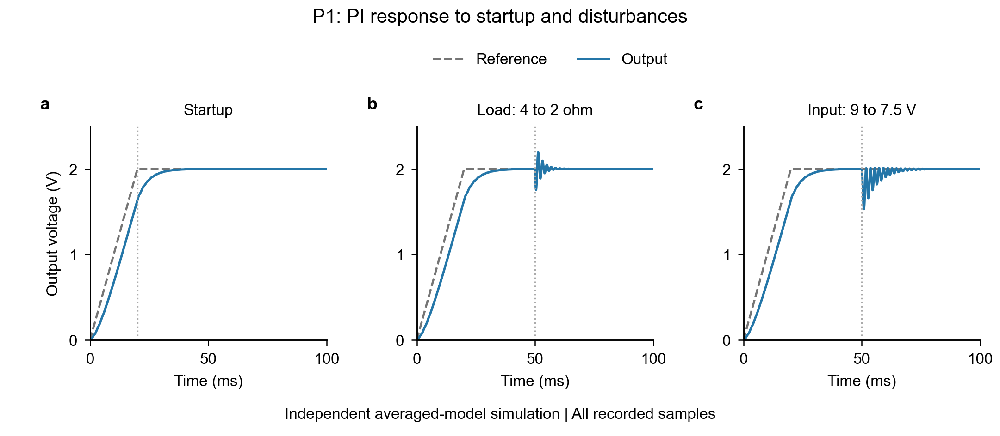
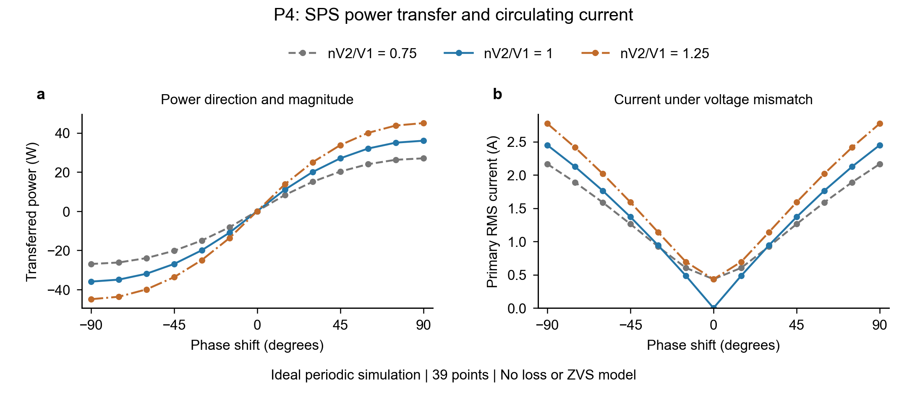
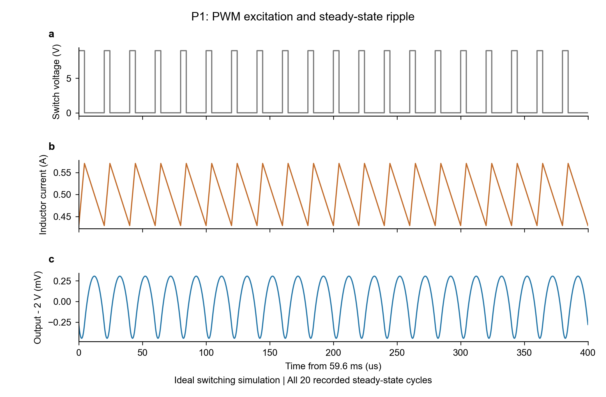
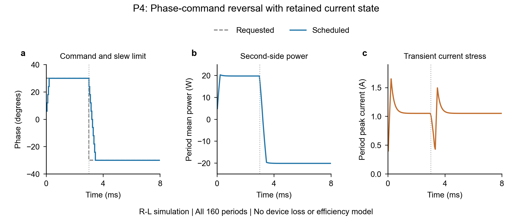

# 实验图表

图表直接读取仓库内已经执行得到的 CSV，使用 Python/matplotlib，不生成或替换实验数据。默认导出可编辑 SVG/PDF 和 PNG 预览。全部数值为仿真，不是硬件测量。

## 图的目的与数据

| 图 | 要回答的问题 | 数据与范围 |
| --- | --- | --- |
| `p1_pi_response` | 当前 PI 能否在软启动与两种扰动后回到目标电压？ | P1 `simulation/results/` 三个工况的全部 5,001 个采样点，各一个面板；统一时间和电压刻度 |
| `p4_sps_transfer` | SPS 如何改变功率方向，电压不匹配时是否仍有交流电流？ | P4 `results/scan.csv` 全部 39 点；左图功率、右图 RMS 电流，按三个电压比分组 |
| `p1_switching_ripple` | 实际 PWM 电压怎样形成电感与输出纹波？ | 固定占空比细步长波形全部 1,660 个数据点；依次显示开关电压、电感电流、相对 2 V 的输出偏差 |
| `p4_direction_reversal` | 限速相移换向怎样改变功率与电流应力？ | 换向工况全部 160 个周期；依次显示指令/执行相移、第二侧功率、每周期峰值电流 |

这是确定性仿真曲线，不是重复试验的均值，不绘制统计误差条或置信区间。没有过滤缺失值、截取有利区间、平滑或重采样。输入 CSV 保持原样；图中单位转换仅为秒→毫秒。

## 复现

在仓库根目录执行 `python figures/plot_results.py`，需要 matplotlib。输出位于 `figures/output/`。本机使用已有 Anaconda Python 3.13.5 和 matplotlib，不改变实验模型使用的解释器。

新增开关与换向图运行 `python figures/plot_dynamic.py`。两图沿用 Python 与可编辑导出，分别采用 183×120 mm 的纵向三面板和 183×80 mm 的横向三面板，都是量化曲线图。Buck 使用原模拟器保存的最后 20 个完整周期，保留边沿重复时刻，横轴相对 59.6 ms，纵轴仅作 `1000×(Vout−2 V)` 换算。DAB 使用已记录的逐周期均值/峰值，曲线不是瞬时功率或瞬时电流，也不能据此单独证明连续性；连续性由原始波形及测试验证。新增图没有再剔除数据、平滑或统计误差条，不作硬件或效率结论。

图的排版以实验报告为目标，宽 183 mm、白底、至少 8 pt 正文字。图源、原始 CSV、可编辑导出和预览共同保留。可选的版面审查脚本存在于 Python 搜索路径时，绘图脚本会额外保存面板对齐检查结果；普通复现不依赖它。

## 预览

图表检查记录见 [QA.md](QA.md)。
